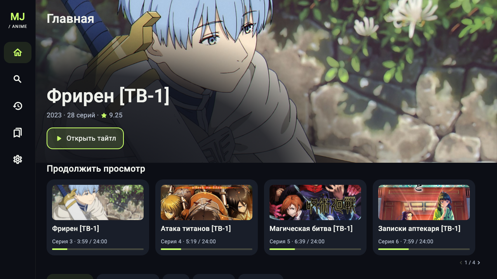
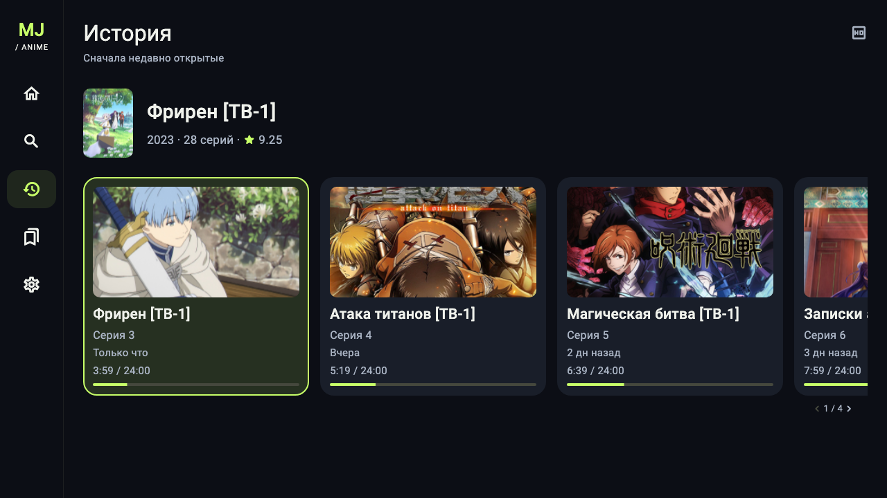
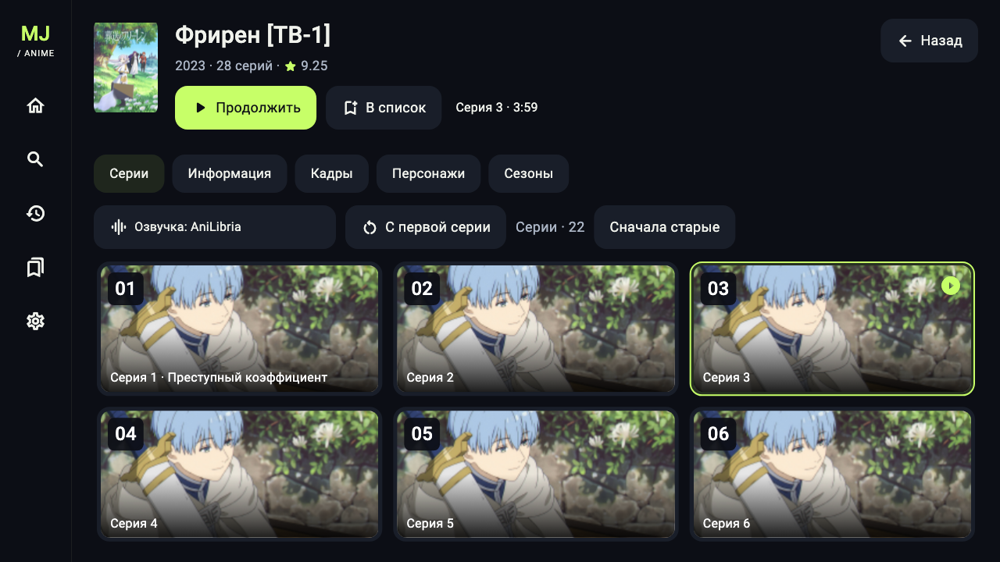
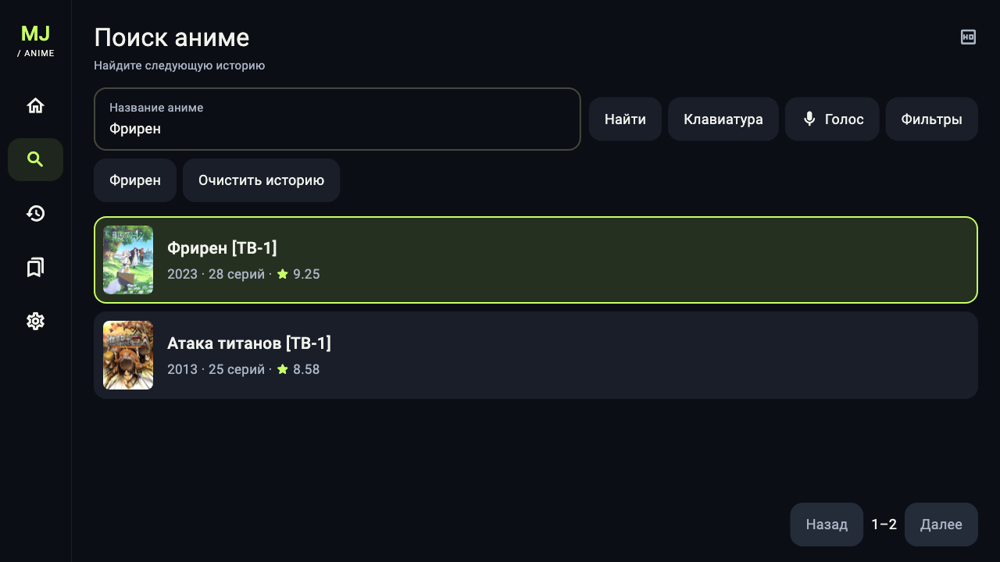
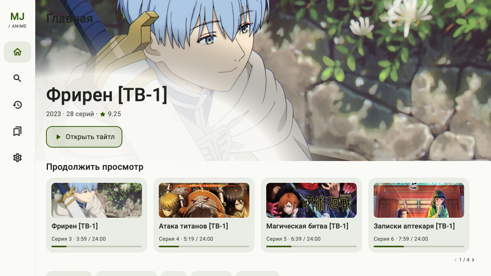

<p align="center"></p>

<p align="center">
  <a href="https://github.com/MJSasha/mj-anime/actions/workflows/ci.yml"></a>
  <a href="https://github.com/MJSasha/mj-anime/releases/latest"></a>
  
  
</p>

<p align="center">
  <a href="https://github.com/MJSasha/mj-anime/releases/latest"><b>Скачать APK</b></a> ·
  <a href="#возможности">Возможности</a> ·
  <a href="#сборка">Сборка</a> ·
  <a href="docs/TESTING.md">Тестирование</a> ·
  <a href="AGENTS.md">Для AI-агентов</a>
</p>

**MJAnime** — приложение для просмотра аниме на Android TV и проекторах Full HD.
Крупные карточки, история с продолжением и плеер, которым удобно управлять обычным пультом.
Оформление — из одной семьи с [MJReader](https://github.com/MJSasha/mj-reader).

*Anime client for Android TV, with remote navigation, watch history and optional Anime4K image processing. Flutter, Kotlin and Media3; ARMv7 / ARM64.*

## Как выглядит



<table>
<tr><td align="center"><b>История</b></td><td align="center"><b>Серии и сезоны</b></td></tr>
<tr><td></td><td></td></tr>
</table>

<details><summary><b>Поиск и светлая тема</b></summary>
<table><tr><td></td><td></td></tr></table>
</details>

Рендеры настоящих Flutter-экранов с локальными демонстрационными данными. В установленном приложении поиск открывает системную клавиатуру Android TV.

## Возможности

| Область | Что умеет |
| --- | --- |
| **Каталог** | Главная с баннером, карусели, поиск, фильтры, рекомендации |
| **Аниме** | Номера серий, выбор озвучки, связанные сезоны, информация, кадры и персонажи |
| **История** | Недавно открытые тайтлы, продолжение со страницы аниме, удаление через долгое OK |
| **Плеер** | HLS/MP4, перемотка пультом, качество, скорость, пропуск опенингов, следующая серия |
| **Изображение** | Off, Light, Anime4K CNN S/M; выбор в плеере, сохранение позиции при переключении |
| **Оформление** | Тёмная и светлая темы, заметный фокус, меню без лишних подписей |
| **Обновления** | GitHub Releases, фоновая проверка раз в сутки, загрузка и системная установка |

Обработка изображения выключена по умолчанию. Производительность CNN зависит от GPU устройства; проверка эмулятором не доказывает плавность на конкретном проекторе.

## Установка и обновления

1. Скачать `MJAnime-<версия>.apk` из [Releases](https://github.com/MJSasha/mj-anime/releases/latest).
2. Передать APK на Android TV и установить. Android 7.0+, ARMv7 или ARM64.
3. Существующий MJAnime обновлять **поверх установленного**, сохраняя настройки и историю.

**Настройки → Обновление MJAnime** показывает новую версию и кнопку «Скачать и установить». Автопроверка выполняется при открытии приложения не чаще раза в сутки; её можно отключить. Она не запускает загрузку сама и не прерывает просмотр. При недоступности GitHub приложение продолжает работать, ручную проверку можно повторить позже.

Перед установкой проверяются SHA-256, размер, имя пакета, возрастающая версия и подпись. При необходимости Android попросит разрешение на установку из MJAnime, затем — подтверждение установки. Сборки до 1.8.0 нужно один раз обновить вручную. Установка без подтверждения системой не выполняется.

## Сборка

Flutter **3.50.0** / Dart **3.14.0**, JDK **21**, Android SDK **36**, Build Tools **36.0.0**. Зависимости закреплены в `pubspec.lock`, локальный fork видеоплагина — в `packages/`.

```sh
flutter pub get --enforce-lockfile
make check
make native-test
make build
```

Если Flutter вне PATH, задайте `FLUTTER_SDK`. `make check` — офлайн-проверки без устройства и аккаунта. Для обновления существующей установки необходим её прежний приватный ключ `.signing/`; новый ключ не подходит. Проверенные APK и метаданные появляются в `dist/`.

Push и PR запускают Checks. Тег `v<версия>` запускает повторные проверки и подписанный выпуск APK с SHA-256 и `update.json`. Правила подписи и секреты описаны в [RELEASING](docs/RELEASING.md).

## Документация

- [Инструкции агентам](AGENTS.md), [архитектура](docs/ARCHITECTURE.md), [вклад](CONTRIBUTING.md)
- [Тесты и проверка APK](docs/TESTING.md), [выпуск](docs/RELEASING.md), [изменения](CHANGELOG.md)
- [Статус и ограничения](STATUS.md), [восстановление платформы](docs/ANDROID-RECOVERY.md)
- [Дизайн семейства MJ](docs/MJANIME-DESIGN.md), [разработка](docs/DEVELOPMENT.md)

Ключи подписи, токены, аккаунты, APK и кеши не хранятся в Git.
